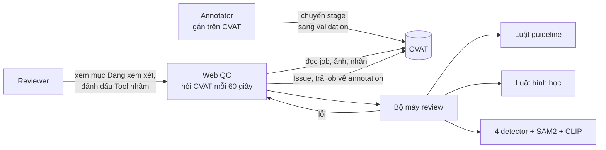
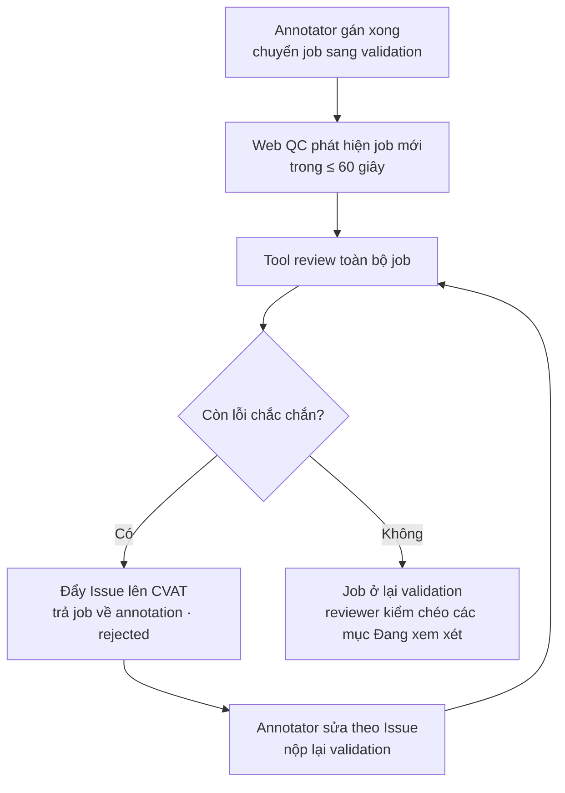

# QC nhãn 2D cho CVAT: review tự động bằng model và luật

> **Đọc trên GitHub (repo `cvat-2d-qc`):** nội dung thư mục `tood qc 2d/cvat_2d/` nằm ở **gốc repo**; LetmeQC (`app.py`, `src/`, `docs/`…) nằm trong thư mục [`letmeqc/`](letmeqc/). Các đường dẫn `tood qc 2d/…` trong tài liệu này là cấu trúc trên máy của nhóm.

Công cụ kiểm tra chất lượng nhãn **object detection + instance segmentation** trên **BDD100K**, gán trên CVAT.

Annotator gán xong và chuyển job sang **validation**. Trong vòng 60 giây, tool tự review job, ghi lỗi lên CVAT thành **Issue** ghim đúng vật có lỗi. Còn lỗi chắc chắn thì tool trả job về annotation. Không còn lỗi chắc chắn thì job chờ reviewer kiểm chéo. **Tool không bao giờ sửa nhãn.**

Mục tiêu: giảm thời gian và công sức của reviewer, và đo được hiệu quả bằng số liệu (tool bắt được bao nhiêu lỗi, bao nhiêu Issue đúng).

---

## Mục lục

1. [Kết quả đo được](#1-kết-quả-đo-được)
2. [Dự án gồm những gì](#2-dự-án-gồm-những-gì)
3. [Luồng làm việc](#3-luồng-làm-việc)
4. [Tool tìm những lỗi gì](#4-tool-tìm-những-lỗi-gì)
5. [Cài đặt](#5-cài-đặt)
6. [Chạy và sử dụng](#6-chạy-và-sử-dụng)
7. [Guideline và file luật](#7-guideline-và-file-luật)
8. [Đo độ chính xác của tool](#8-đo-độ-chính-xác-của-tool)
9. [Cấu trúc thư mục](#9-cấu-trúc-thư-mục)
10. [LetmeQC (phần cũ, đã tắt)](#10-letmeqc-phần-cũ-đã-tắt)
11. [Xử lý lỗi thường gặp](#11-xử-lý-lỗi-thường-gặp)
12. [Bảo mật](#12-bảo-mật)
13. [Giới hạn và việc tiếp theo](#13-giới-hạn-và-việc-tiếp-theo)
14. [Tài liệu liên quan](#14-tài-liệu-liên-quan)

---

## 1. Kết quả đo được

Cách đo: lấy ảnh có đáp án (nhãn đúng), **cố ý cài lỗi đã biết** vào nhãn, cho tool review như một job thật, rồi đếm số lỗi tool bắt được, bỏ lọt và báo nhầm. Ảnh dùng để báo cáo **không dùng để chỉnh tool**.

Các số dưới đây là độ chính xác **của tool**, không phải của annotator. Đo ngày 2026-10-18.

Đo lại ngày 2026-10-18 sau khi sửa 2 chỗ trong cách đo: lỗi "trùng box" cài vào giờ chép từ box đang có (trước đó có lúc chép box của vật đã bị xoá, tool không thể bắt); lỗi cài vào vùng đáp án ghi "bỏ qua" (đám đông, vật quá mờ) không tính nữa, vì ghi chú của tool ở vùng đó vốn bị bỏ khi chấm. Ảnh Việt Nam có nhiều vùng như vậy (123/433 lỗi cài vào) nên số Việt Nam tăng từ 70,4% lên 94,5%. Số này **không gồm cảnh đám đông dày đặc**, nơi tool vẫn yếu (xem mục 13).

| Chỉ số | BDD100K (335 ảnh, vật từ 10 px) | Ảnh đường phố Việt Nam (123 ảnh) |
|---|---|---|
| **Bắt được lỗi** (gồm cả lỗi ghi "Đang xem xét") | **76,7%** | 94,5% |
| **Issue "chắc chắn" là lỗi thật** | **86%** | 94% |
| **Báo nhầm chắc chắn / 100 box đúng** | **1,45** | 0,7 |
| Tool nói ảnh "sạch" thì ảnh sạch thật | 98% | 100% |

Cách đọc các chỉ số:
- **Bắt được lỗi:** annotator mắc 100 lỗi thì tool tìm ra bao nhiêu.
- **Issue chắc chắn là lỗi thật:** tool ghi 100 Issue "lỗi" thì bao nhiêu cái đúng là lỗi. Phần còn lại là annotator làm đúng mà tool báo nhầm.
- **Báo nhầm / 100 box đúng:** cho tool review nhãn hoàn toàn đúng, cứ 100 box thì tool báo nhầm bao nhiêu lỗi chắc chắn.

**Theo loại lỗi (BDD100K):**

| Loại lỗi | Bắt được |
|---|---|
| Trùng box | 100% |
| Box thừa | 88% |
| Sai kích thước | 81% |
| Thiếu vật | 73% |
| Sai nhãn | 61% |

**Theo điều kiện ảnh:** ban ngày và hoàng hôn khoảng 79%, ban đêm khoảng 71%.

**So với bản trước cải tiến**, cùng ảnh và cùng lỗi cài vào:

| Chỉ số | Trước | Sau |
|---|---|---|
| Bắt được lỗi | 74,9% | 76,7% |
| Issue chắc chắn đúng | 72% | 86% |
| Báo nhầm chắc chắn / 100 box | 4,0 | 1,45 |

**Instance segmentation (polygon), 80 ảnh COCO:** bắt 74,9% lỗi polygon cài vào. Báo nhầm 1,3 lỗi chắc chắn trên 100 polygon đúng.

**Test đầu cuối trên CVAT** (2026-10-16, chạy lại 2026-10-18): tạo job, cài lỗi, tool tự review, đẩy Issue, annotator sửa, review vòng 2.
- Job BDD100K có box + polygon: bắt **10/10** lỗi cài vào (8 chắc chắn, 2 đang xem xét).
- Tự review khi chuyển job sang validation (2026-10-18, job 52 box): web nhận job sau 30 giây, review xong sau 60 giây, đẩy Issue và trả job về annotation.
- Lỗi ID của track: **7/7** kịch bản đạt.
- Job video gán bằng Track: **6/6** kịch bản đạt.

Xem đầy đủ kèm biểu đồ trên Web QC, trang **Độ tin cậy tool** (`http://localhost:8000/#tab=trust`).

---

## 2. Dự án gồm những gì

| Thành phần | Thư mục | Trạng thái |
|---|---|---|
| **Web QC**: web review, tự review khi job sang validation, ghi Issue, báo cáo | `tood qc 2d/cvat_2d/web_qc/` | **Đang dùng** |
| **Bộ máy review**: luật hình học, so với model, segmentation, lỗi ID | `tood qc 2d/cvat_2d/*.py` | Đang dùng |
| **Guideline BDD100K**: guideline, tập nhãn CVAT, file luật | `tood qc 2d/cvat_2d/guideline_bdd100k/` | Đang dùng |
| **Thư viện SAM2** và checkpoint | `tood qc 2d/sam2/`, `tood qc 2d/checkpoints/` | Bắt buộc |
| **LetmeQC**: webhook server chỉ dùng luật | `app.py`, `src/` | **Đã tắt** (luật đã gộp vào Web QC) |

Cách các phần nối với nhau:



Repo con `tood qc 2d/cvat_2d` là một git repo riêng (`github.com/letuan2k2/cvat-2d-qc`). Repo ngoài (thư mục gốc) **không lưu** thư mục `tood qc 2d/`: model, venv, dữ liệu và token đều nằm trong `.gitignore`.

---

## 3. Luồng làm việc



Ở vòng review sau: Issue của lỗi đã sửa được **tự đóng**, lỗi còn thì **giữ Issue cũ** (không tạo trùng). Mỗi lần job bị trả về được tính là một vòng.

**Ai làm gì:**

| Người | Dùng gì | Việc |
|---|---|---|
| Annotator | **Chỉ CVAT** | Gán nhãn, chuyển validation, đọc Issue, sửa, nộp lại. Không cần mở Web QC. |
| Reviewer | Web QC: **Tự review → Chờ reviewer** | Xem các mục "Đang xem xét", bấm **Tool nhầm** khi tool sai, kiểm chéo job tool cho qua. |
| Trưởng nhóm | Web QC: **Tổng quan, Độ tin cậy, Guideline** | Theo dõi chất lượng và hiệu quả Issue, soạn guideline và luật. |

Web QC **phải luôn bật** trên một máy có GPU. Tắt web là tool ngừng tự review.

---

## 4. Tool tìm những lỗi gì

### Các loại lỗi

| Nhóm | Lỗi |
|---|---|
| **Box** | Sai kích thước (chưa khít, lệch), quá dẹt hoặc quá mảnh, ra ngoài ảnh, gần như không có diện tích, trùng box (cùng nhãn hoặc khác nhãn trên một vật) |
| **Nhãn** | Sai nhãn (car / truck / bus, xe máy / xe đạp…), thiếu vật, box thừa (biển báo, quảng cáo, bóng phản chiếu), người ngồi trên xe máy gán thành `pedestrian` thay vì `rider` |
| **Polygon / mask** | Vẽ lẹm viền, phình ra nền, lệch vật, mất một phần vật, polygon xoắn, dưới 3 điểm, tràn ra ngoài box của nó |
| **Vùng đường** (`drivable_area`) | Tô thiếu, tô thừa, vẽ trùng |
| **Track (video)** | Tráo ID, đổi vật, một vật hai ID, hai ID một vật, track kết thúc sớm, kích thước không đồng bộ, gán bằng Shape hay Track sai guideline |
| **Cả ảnh** | Ảnh thiếu tag (`image_info`, `weather`…), giá trị tag không hợp với ảnh (kiểm bằng CLIP) |
| **Guideline** | Thiếu thuộc tính bắt buộc, vi phạm quy định trong file luật; số mục guideline được ghi vào Issue |

### Năm tầng kiểm tra

1. **Luật guideline:** kích thước tối thiểu, thuộc tính bắt buộc, vẽ toàn bộ vật hay chỉ phần nhìn thấy, Shape hay Track.
2. **Luật hình học** (gộp từ LetmeQC): không cần GPU, gần như không báo nhầm.
3. **So với model:**
   - 4 detector (YOLO11x, RT-DETR-x, YOLOv8x-seg, D-FINE-X) bỏ phiếu chọn vật.
   - SAM2 thu box sát mép vật.
   - CLIP phân biệt car / truck / bus và vật giả (biển báo, quảng cáo).
   - Dải giữa ảnh được phóng to khoảng 2,4 lần để soi vật nhỏ ở xa.
4. **Chắc chắn hay Đang xem xét** (xem mục dưới).
5. **Ghi Issue lên CVAT:** mỗi vật một Issue, ghim vào đúng box của vật đó.

### "Lỗi" và "Đang xem xét"

Tool chỉ ghi **lỗi chắc chắn** khi đủ bằng chứng, ví dụ:
- Mép box lệch từ 20% cạnh vật trở lên.
- Với lỗi nhầm loại xe, CLIP cũng đồng ý với model.

Các trường hợp còn lại được ghi **"Đang xem xét — có thể …"** kèm lý do, để annotator kiểm chứng:
- Box lệch ít.
- Vật bị vật khác che.
- Vùng ảnh quá tối.
- Vật mờ, nhỏ, chỉ một số model thấy.

Chỉ lỗi chắc chắn mới làm job bị trả về.

### Nội dung Issue

- **Mỗi vật một Issue**, ghim vào box của chính vật đó. Vật ra ngoài ảnh thì ghim phần nằm trong ảnh. Vật bị thiếu thì ghim ở chỗ tool thấy vật.
- **Một vật nhiều lỗi thì gộp vào một Issue** và ghi rõ tên từng lỗi:

```
'car' này có 3 lỗi: Sai kích thước, Lỗi ID: đổi vật (ID switch), Sai nhãn.
1. [Sai kích thước] Box chưa khít: cạnh dưới thừa 14px.
2. [Lỗi ID: đổi vật (ID switch)] Đổi vật: tới khung 3, track 7 chuyển sang xe bên cạnh. Mỗi track chỉ theo 1 vật.
3. [Sai nhãn] Đang xem xét — có thể sai nhãn: giống 'truck' hơn. Kiểm tra lại: nhãn đúng thì giữ nguyên và trả lời Issue này, sai thì sửa.
```

Dòng cuối Issue có mã `[qc:frame|loại|vật]`. Tool dùng mã này để không tạo Issue trùng và để đo "% Issue đúng"; annotator bỏ qua dòng này.

### Nhãn tool hiểu

Tool tự khớp tên nhãn của task với các lớp của model, kể cả khi tên khác hoặc gõ sai nhẹ:

| Tool hiểu là | Tên nhãn trong task |
|---|---|
| Xe 4 bánh | `car`, `truck`, `bus`, `Van`, `oto`, `xe tai`… |
| Xe 2 bánh | `motorcycle`, `bicycle`, `xe may`… |
| Người | `pedestrian`, `person`, `rider`, `Person_sitting`, `Cyclist`… (cả `perdestrian` gõ sai) |

Nhãn model không chấm, như `traffic sign`, `Tram`, `Misc`, vẫn được kiểm bằng luật hình học, kể cả lỗi trùng box.

---

## 5. Cài đặt

### Yêu cầu

- Windows 10/11, Python 3.11–3.13. Khi cài Python, tick "Add python.exe to PATH".
- Git.
- GPU NVIDIA. Trên RTX 4050 Laptop, chế độ chính xác: khoảng 5–20 giây mỗi ảnh mới, khoảng 1 giây mỗi ảnh đã có cache. Không có GPU vẫn chạy được nhưng rất chậm.
- Khoảng 10 GB ổ trống: model khoảng 3 GB, SAM2.1 large khoảng 0,9 GB.
- Một máy CVAT (bản 2.x; đã thử với 2.78.1) và token: CVAT → **Profile → Security → Personal Access Tokens**.

### Cài trên máy mới

Thư mục `cvat_2d` phải nằm **bên trong một bản SAM2**, vì tool dùng thư viện `sam2` ở thư mục cha:

```bat
git clone https://github.com/facebookresearch/sam2.git
cd sam2
git clone https://github.com/letuan2k2/cvat-2d-qc.git cvat_2d
cvat_2d\cai_dat.bat
```

`cai_dat.bat` làm hết các bước sau. Lần đầu mất khoảng 15–30 phút và cần Internet:
- Tạo `venv`.
- Cài torch bản CUDA (nếu máy có GPU NVIDIA) và các thư viện trong `requirements.txt`, **đúng phiên bản đã chạy thử** ghi trong `rang_buoc_phien_ban.txt`.
- Tải model: SAM2.1 large, YOLO11x, RT-DETR-x, YOLOv8x-seg, D-FINE-X, CLIP ViT-L/14, SegFormer-b5.

Trên máy hiện tại, mọi thứ đã có sẵn trong `tood qc 2d/`: thư mục `sam2/` là thư viện SAM2, `cvat_2d/` là tool, `venv/` là môi trường Python, `checkpoints/` chứa SAM2.1.

---

## 6. Chạy và sử dụng

### Chạy Web QC

```bat
"tood qc 2d\cvat_2d\web_qc.bat"           :: chỉ máy này: http://localhost:8000
"tood qc 2d\cvat_2d\web_qc.bat" --lan     :: máy khác cùng mạng vào được: http://<IP máy này>:8000
```

Thêm `--port 8080` nếu muốn dùng cổng khác.

### Lần đầu sử dụng

1. **Đăng nhập** bằng tài khoản `admin`. Mật khẩu lần đầu nằm trong `cvat_2d\web_qc\data\MAT_KHAU_ADMIN.txt`. Đăng nhập xong thì vào **Cài đặt** đổi mật khẩu rồi xoá file đó.
2. **Kết nối CVAT:** bấm **Thêm kết nối**, nhập địa chỉ CVAT và token, bấm **Thử kết nối** rồi **Lưu**. Token được mã hoá khi lưu.
3. **Guideline:** tải lên `guideline_bdd100k/GUIDELINE_BDD100K.md`, bấm **Đọc guideline + lấy nhãn từ task**, kiểm lại bảng luật rồi bấm **Lưu luật**. Sau đó **gán guideline cho task**, hoặc đặt làm guideline mặc định trong Cài đặt.
4. **Bật tự review:** vào **Cài đặt → Tự review khi job chuyển sang validation**, tick **Bật**, chọn kết nối CVAT, rồi **Lưu cài đặt**.

### Các trang của web

| Trang | Để làm gì |
|---|---|
| **Tự review** (trang mở đầu) | Sơ đồ luồng kèm số liệu sống; bảng mỗi job một dòng, có % box đúng qua từng vòng; job chờ reviewer (annotator bị trả về nhiều nhất xem ở Tổng quan → Theo labeler) |
| **Tổng quan** | Tỉ lệ đạt, loại lỗi hay gặp, xu hướng theo ngày, thống kê theo labeler, **Hiệu quả Issue** đo trên job thật (% Issue đúng, lỗi bắt trước khi review chéo, số vòng trả về / job) |
| **Review job** | Review một job bằng tay. Có danh sách lỗi kèm ảnh phóng to; chế độ **Phân tích** vẽ nhãn của labeler cạnh những gì tool thấy; xem theo khung hình; xem Issue trên CVAT; nút Tool nhầm, sửa lời nhắn, ghi chú trên ảnh; đẩy Issue |
| **Lịch sử** | Mọi lần review, lọc theo job hoặc người |
| **Độ tin cậy tool** | Số đo độ chính xác của tool kèm biểu đồ, giải thích cách đo và các giới hạn |
| **Guideline** | Tải guideline, soạn luật dạng bảng hoặc YAML, gán cho task, tìm trong guideline |
| **Kết nối CVAT / Cài đặt** | Quản lý kết nối, ngưỡng đạt, tự review, webhook, tài khoản (vai trò labeler / qc / admin) |

Mở thẳng một trang bằng link: `#tab=auto`, `#tab=dash`, `#tab=trust`, `#tab=history`, `#tab=guide`, `#tab=conn`, `#tab=settings`. Mở một lần review: `#run=<số>`.

Ngoài ra web có **trang lỗi cho labeler**: bấm **Copy link gửi labeler** để lấy link. Labeler mở được mà không cần đăng nhập.

### Review bằng dòng lệnh (không cần web)

```bat
"tood qc 2d\cvat_2d\review.bat" --job 57                 :: đọc CVAT_URL / CVAT_TOKEN trong cvat_2d\.env
"tood qc 2d\cvat_2d\review.bat" --file export.zip        :: chấm file export (CVAT for images 1.1 / COCO / YOLO)
```

Các tuỳ chọn khác: `--nhanh` (máy yếu), `--khong-nguoi-lai` (job không gán box riêng cho người lái xe máy).

---

## 7. Guideline và file luật

Guideline cho bài toán nằm ở `tood qc 2d/cvat_2d/guideline_bdd100k/`:

| File | Nội dung |
|---|---|
| `GUIDELINE_BDD100K.md` | Guideline gán nhãn BDD100K: object detection và instance segmentation, 10 nhãn, thuộc tính, quy tắc box / polygon, vật bị che, rider |
| `labels_bdd100k.json` | Tập nhãn để tạo task trên CVAT |
| `luat_bdd100k.yaml` | File luật cho tool (dán vào ô YAML trên trang Guideline) |

**Các quy định chính:**
- **Chỉ vẽ phần nhìn thấy** của vật bị che.
- **Gán bằng Shape** (ảnh rời), không dùng Track.
- **Mỗi vật vừa có box vừa có polygon**, polygon nằm trong box.
- **Người lái xe máy / xe đạp** là `rider`, có box riêng.
- **Vật có cạnh ngắn dưới 10 px không bắt buộc gán** (mục 3.5a, chốt 2026-10-17). Đã gán thì vẫn hợp lệ.

Tool đọc guideline thành luật. Nếu task chưa có luật, mỗi lần review tool tự đọc các câu yêu cầu trong guideline. Các khoá chính trong file luật:

| Khoá | Ý nghĩa |
|---|---|
| `nhan.<tên>.loai_tool` | Tool hiểu nhãn này là gì (car, truck, bus, motorcycle, bicycle, person) |
| `nhan.<tên>.thuoc_tinh_bat_buoc` | Thuộc tính phải chọn; để trống là lỗi |
| `nhan.<tên>.kich_thuoc_toi_thieu_px` | Box nhỏ hơn mức này là **lỗi** |
| `quy_tac.khong_bat_buoc_duoi_px` | Vật nhỏ hơn mức này **không bắt buộc gán**, đã gán vẫn hợp lệ |
| `quy_tac.toan_bo_vat` | `false` = chỉ vẽ phần nhìn thấy |
| `quy_tac.kieu_nhan` | `shape` (ảnh rời) hoặc `track` (video) |
| `quy_tac.polygon_kem_box` | `cap` = instance segmentation; `trung` = chỉ cần một trong hai |
| `quy_tac.nguoi_lai_co_box_rieng` | Người lái xe có box riêng hay không |

Web lưu một bản guideline riêng trong cơ sở dữ liệu của nó. Sửa file `.md` / `.yaml` trong repo thì phải **tải lại lên trang Guideline**, hoặc sửa trực tiếp trên web rồi bấm **Lưu luật**.

---

## 8. Đo độ chính xác của tool

Các lệnh dưới đây chạy từ thư mục `tood qc 2d`.

**Box (object detection):**

```bat
:: Bộ BDD100K: --visible = chỉ vẽ phần nhìn thấy, --min-px 10 = guideline 10 px, --skip 400 = 335 ảnh giữ riêng
venv\Scripts\python cvat_2d\review_eval.py --images D:\DATA_EXT\bdd_eval\images --gt D:\DATA_EXT\bdd_eval\gt ^
    --meta D:\DATA_EXT\bdd_eval\dieu_kien.json --visible --min-px 10 --skip 400 --json ket_qua.json --rows tung_loi.json

:: Bộ ảnh Việt Nam (mặc định đọc D:\DATA)
venv\Scripts\python cvat_2d\review_eval.py --min-px 10 --json ket_qua_vn.json
```

| Tuỳ chọn | Ý nghĩa |
|---|---|
| `--limit N` / `--skip N` | Chỉ chạy N ảnh / bỏ qua N ảnh đầu. 400 ảnh đầu BDD dùng để chỉnh, 335 ảnh sau dùng để báo cáo |
| `--rows file` | Lưu kết quả **từng lỗi**: loại, cỡ vật, bắt hay sót |
| `--dump file` | Lưu từng mục tool báo nhầm, để mở ra xem |
| `--cond dem` / `--cond mua` | Giả lập ảnh đêm / mưa từ ảnh ngày |
| `--no-far` | Tắt phóng to dải giữa ảnh (để so sánh) |

**Segmentation (polygon):**

```bat
venv\Scripts\python cvat_2d\review_eval.py --seg cvat_2d\du_lieu_danh_gia\coco_seg_eval --skip 120 --json seg.json
```

**Cập nhật trang "Độ tin cậy tool"** sau khi đo:

```bat
venv\Scripts\python cvat_2d\web_qc\tao_do_tin_cay.py --bdd-new ket_qua.json --vn-new ket_qua_vn.json --seg seg.json
```

**Test đầu cuối trên CVAT:** dùng kết nối số 2 của Web QC (mặc định là CVAT localhost chạy bằng Docker). Test chạy trên bản sao dữ liệu web, không động tới lịch sử thật.

```bat
venv\Scripts\python cvat_2d\kiem_thu\test_e2e_bdd.py     :: box + polygon, 10 lỗi cài, đẩy Issue, review vòng 2, đo hiệu quả
venv\Scripts\python cvat_2d\kiem_thu\test_e2e_id.py      :: lỗi ID của track
venv\Scripts\python cvat_2d\kiem_thu\test_e2e_track.py   :: job video gán bằng Track
```

Kết quả được ghi vào `cvat_2d/kiem_thu/ket_qua/`.

**Dữ liệu đánh giá trên máy:**

| Thư mục | Nội dung |
|---|---|
| `D:\DATA` | 123 ảnh đường phố Việt Nam kèm đáp án |
| `D:\DATA_EXT\bdd_eval` | 735 ảnh BDD100K kèm đáp án, chia theo ngày/đêm và thời tiết |
| `D:\DATA_EXT\exdark_eval` | 150 ảnh rất tối |
| `D:\DATA_EXT\bdd_train` | 9.265 ảnh BDD100K dạng YOLO, dùng để huấn luyện |
| `tood qc 2d\cvat_2d\du_lieu_danh_gia\` | Có trong repo: `coco_seg_eval` (200 ảnh COCO có polygon do người vẽ), `bdd_e2e` (4 ảnh BDD100K cho test đầu cuối) |

---

## 9. Cấu trúc thư mục

```
dự án nhóm/
├── README.md                      # file này
├── app.py, src/                   # LetmeQC: webhook + luật (ĐÃ TẮT, xem mục 10)
├── data/                          # ảnh mẫu của LetmeQC
├── docs/                          # tài liệu LetmeQC (API CVAT, luật, bài học)
├── CVAT_WEBHOOK_GUIDE.md          # hướng dẫn webhook của LetmeQC
└── tood qc 2d/                    # (không lưu trong repo ngoài)
    ├── sam2/                      # thư viện SAM2
    ├── checkpoints/               # sam2.1_hiera_large.pt
    ├── venv/                      # môi trường Python
    └── cvat_2d/                   # repo cvat-2d-qc
        ├── web_qc/                # Web QC
        │   ├── server.py          #   API (FastAPI), đăng nhập, webhook
        │   ├── worker.py          #   hàng đợi review, tự review khi sang validation, đẩy Issue, trả job
        │   ├── store.py           #   cơ sở dữ liệu SQLite, mã hoá token
        │   ├── guideline.py       #   đọc guideline, file luật, tầng 1
        │   ├── hieu_qua.py        #   đo % Issue đúng trên job thật
        │   ├── tao_do_tin_cay.py  #   tạo số liệu cho trang Độ tin cậy
        │   ├── static/            #   giao diện (index.html, app.js, style.css, bao-cao.html)
        │   └── data/              #   CSDL, guideline đã tải, khoá (không commit)
        ├── review_core.py         # bộ máy review: so nhãn với model, gộp Issue, đẩy lên CVAT
        ├── rule_tier.py           # luật hình học (gộp từ LetmeQC)
        ├── seg_check.py           # polygon / mask từng vật (so với SAM2)
        ├── area_check.py          # vùng đường drivable_area
        ├── frame_check.py         # tag cho cả ảnh
        ├── id_check.py            # lỗi ID của track
        ├── label_hq_2d.py         # 4 detector + SAM2 + CLIP (cũng dùng để gán nhãn tự động)
        ├── review_eval.py         # đo độ chính xác của tool
        ├── review.py              # review bằng dòng lệnh
        ├── guideline_bdd100k/     # guideline, tập nhãn, file luật BDD100K
        ├── kiem_thu/              # test đầu cuối trên CVAT
        ├── du_lieu_danh_gia/      # bộ ảnh đo: coco_seg_eval (200 ảnh), bdd_e2e (4 ảnh)
        ├── cache_hq2d/            # cache kết quả detect (không commit)
        ├── review_out/            # kết quả từng lần review (không commit)
        ├── *.bat                  # web_qc, review, cai_dat, menu
        └── README.md, web_qc/TAI_LIEU_WEB_QC.md
```

---

## 10. LetmeQC (phần cũ, đã tắt)

LetmeQC là phiên bản đầu của nhóm:
- **Webhook server** (`app.py`): CVAT gọi vào khi job đổi trạng thái, tool kiểm nhãn bằng luật, tạo Issue và trả job về annotation.
- **Bản dòng lệnh** (`src/main.py`): kiểm file COCO JSON.

**Vì sao tắt (2026-10-16):** LetmeQC và Web QC cùng nhận sự kiện từ CVAT và cùng dùng cổng 8000. Chạy cả hai thì một job bị review hai lần và có Issue trùng. Toàn bộ luật của LetmeQC đã được gộp vào `rule_tier.py` của Web QC:
- box ra ngoài ảnh, box quá nhỏ, tỉ lệ cực đoan;
- polygon dưới 3 điểm, polygon xoắn, mask tràn ra ngoài box;
- trùng box, người nằm trong xe.

Phần trả job về annotation cũng có ở Web QC.

**Muốn chạy lại để so sánh:**

```bat
set LETMEQC_ENABLE=1
python app.py
```

Không có biến này thì `app.py` tự thoát kèm thông báo.

**Bản dòng lệnh** vẫn dùng được:

```bat
pip install -r requirements.txt
python src/main.py <file_coco.json> --min-area 100 --iou-threshold 0.95 --output loi.json -v
```

Thư mục `tests/` hiện chưa có test nào. (2026-10-17 đã sửa 3 lỗi làm LetmeQC không chạy được: thiếu `import List` trong `src/error_templates.py`; bản dòng lệnh gọi `parse_coco_json` đã bị xoá ở commit `743930d` (đã khôi phục); lỗi thiếu thuộc tính chưa có mẫu lời nhắn. Thêm `shapely` vào `requirements.txt`.)

Cấu hình qua `.env` (xem `.env.example`): `CVAT_API_URL`, `CVAT_TOKEN`, `WEBHOOK_SECRET`, `MIN_BOX_AREA`, `IOU_THRESHOLD`, `SERVER_HOST`, `SERVER_PORT`. Chi tiết webhook xem [CVAT_WEBHOOK_GUIDE.md](letmeqc/CVAT_WEBHOOK_GUIDE.md).

---

## 11. Xử lý lỗi thường gặp

| Hiện tượng | Cách xử lý |
|---|---|
| **Thử kết nối báo "Invalid token" (401)** | Token đã hết hạn hoặc bị thu hồi. Tạo token mới trên CVAT (Profile → Security → Personal Access Tokens), sửa kết nối, dán token mới rồi lưu. |
| Bấm Đánh giá báo lỗi thiếu thư viện `sam2` | `cvat_2d` không nằm cạnh thư viện SAM2. Xem mục 5. |
| Chạy rất chậm, thanh trạng thái báo "CPU (chậm)" | Torch chưa dùng được GPU. Cài lại torch bản CUDA: `venv\Scripts\pip install torch torchvision --index-url https://download.pytorch.org/whl/cu126` |
| `web_qc.bat` báo "Chưa có venv" | Chạy `cai_dat.bat`, hoặc tạo `venv` ở `cvat_2d\venv` hoặc thư mục cha. |
| Cổng 8000 đang bị dùng | Có thể LetmeQC hoặc một bản web khác đang chạy. Tắt nó đi, hoặc chạy `web_qc.bat --port 8080`. |
| Chọn job thì báo "Job 3D (lidar)" | Web chỉ review job 2D. Chọn job khác. |
| Tự review không chạy | Kiểm tra: đã tick Bật và Lưu trong Cài đặt; trang **Tự review** có báo lỗi hỏi CVAT không; job có thật sự chuyển sang **validation** không. Lần đầu bật, tool chỉ ghi nhận các job đang có, không review job cũ. |
| Không thấy CVAT localhost | Mở Docker Desktop. Các container `cvat_*` sẽ tự chạy, sau khoảng 30 giây `http://localhost:8080` sẵn sàng. |
| Sửa guideline mà tool không theo | Web dùng bản guideline lưu trong cơ sở dữ liệu. Tải lại file lên, hoặc sửa luật trên web rồi bấm Lưu luật. |
| Tool báo thiếu nhiều vật rất nhỏ | Đặt "Không bắt buộc gán vật dưới (px)" trong luật của guideline. |

---

## 12. Bảo mật

- **Không commit** các file sau (đã có trong `.gitignore`):
  - `cvat_2d/.env`, `.env.class`;
  - `web_qc/data/` (cơ sở dữ liệu, token đã mã hoá, `secret.key`, mật khẩu admin lần đầu);
  - model `*.pt`, `*.ts`, `*.onnx`;
  - `review_out/`, `cache_hq2d/`.
- Token CVAT được mã hoá khi lưu và không bao giờ gửi lên trình duyệt.
- Webhook kiểm chữ ký HMAC bằng secret.
- **Không mở web ra Internet khi chưa có HTTPS.** Trong mạng nội bộ thì dùng `--lan`.
- Chia vai trò tài khoản:
  - **labeler:** chạy review, xem, đẩy Issue;
  - **qc:** thêm quyền quản lý guideline và kết nối;
  - **admin:** thêm quyền quản lý tài khoản và cài đặt.

---

## 13. Giới hạn và việc tiếp theo

**Giới hạn hiện tại:**
- **Vật nhỏ 10–20 px** là chỗ yếu nhất: tool chỉ bắt khoảng một nửa số lỗi ở cỡ này, trong khi vật trên 60 px bắt khoảng 90%. Khoảng một phần ba số vật 10–15 px không model nào thấy, kể cả khi đã phóng to.
- **Ảnh đêm** bắt kém hơn ban ngày khoảng 8 điểm % (71% so với 79%).
- **Cảnh đám đông dày đặc** (người, xe máy ở Hà Nội): tool mới tìm được khoảng 40% số người. Số 94,5% của ảnh Việt Nam không gồm các vùng này.
- Các số ở mục 1 đo bằng **lỗi cài vào**. Số "% Issue đúng" trên **job thật** chỉ có sau khi annotator sửa theo Issue (Tổng quan → Hiệu quả Issue). Hiện mới đo trên 1 job giả lập (75% sau vòng 1, 67% sau vòng 2).
- Tool là **trợ lý của reviewer**. Reviewer vẫn cần kiểm chéo job tool cho qua, ít nhất là xem ngẫu nhiên một phần.

**Việc tiếp theo:**
1. **Huấn luyện thêm detector trên BDD100K** (9.265 ảnh có sẵn) để thấy xe nhỏ và ảnh đêm tốt hơn. Trước khi chấm phải kiểm tra ảnh huấn luyện không trùng với ảnh dùng để chấm.
2. **Đo trên 3–5 job thật:** % Issue đúng, lỗi reviewer tìm thêm, số vòng trả về / job.
3. **Giới hạn số vòng trả về** (ví dụ 3 vòng), quá mức thì chuyển cho reviewer, để annotator và tool không đẩy qua đẩy lại mãi.
4. **Chạy Web QC như một dịch vụ** tự khởi động cùng Windows, và sao lưu `web_qc/data/` hằng ngày.

---

## 14. Tài liệu liên quan

- [Tài liệu đầy đủ của Web QC](web_qc/TAI_LIEU_WEB_QC.md): cách tool tìm lỗi, nội dung Issue, đồng bộ Issue, đo hiệu quả, bảo mật, xử lý lỗi.
- [README của repo](README.md): cài đặt trên máy mới, chạy web, đo độ chính xác.
- [Guideline BDD100K](guideline_bdd100k/GUIDELINE_BDD100K.md) và [file luật](guideline_bdd100k/luat_bdd100k.yaml).
- [CVAT_WEBHOOK_GUIDE.md](letmeqc/CVAT_WEBHOOK_GUIDE.md), [docs/](letmeqc/docs/): tài liệu của LetmeQC.
- [CVAT](https://docs.cvat.ai/) · [BDD100K](https://doc.bdd100k.com/) · [SAM2](https://github.com/facebookresearch/sam2)

---

Dự án thuộc sở hữu của VinAI. Vui lòng liên hệ nhóm trước khi sử dụng cho mục đích thương mại.
